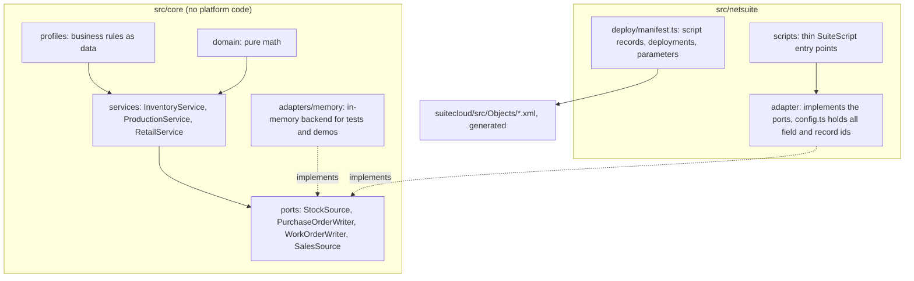

# Shopfloor

Open-source operations logic for **small companies, light manufacturers, and
local shops**: inventory reorder, production planning, and daily close-out.
Written in TypeScript, platform-agnostic at the core, with a ready-to-deploy
**NetSuite** adapter.

Most ERP examples are either one-off snippets or enterprise frameworks. This
repo sits in between: a small, tested codebase that solves the problems a 5 to
200 person business actually has, built so the business rules do not care which
system holds the data.

> Status: example / reference implementation. Every module ships in **dry-run
> mode** so you can see what it would do before it writes a single record.
> Try it in a sandbox account first.

## How it is organized



| Folder | What lives there | Depends on |
|---|---|---|
| `src/core/profiles` | Business profiles (general, manufacturing, retail) as plain data | nothing |
| `src/core/domain` | Reorder, build sizing, BOM, daily close math. Pure functions | profiles |
| `src/core/ports` | The small interfaces a back end must implement | domain types |
| `src/core/services` | Orchestration: plan, dry run, write | ports |
| `src/core/adapters/memory` | A working back end with plain arrays | ports |
| `src/netsuite/adapter` | NetSuite implementation of the ports + `config.ts` | core, N/* |
| `src/netsuite/scripts` | Scheduled scripts and the RESTlet | adapter |
| `src/netsuite/deploy` | Deployment manifest for SuiteCloud | nothing |

`src/core` never imports NetSuite. ESLint and `npm run agent:validate` both fail
if it does.

### Using the core without NetSuite

The core is its own build: `npm run build:core` compiles `src/core` to plain
CommonJS with type definitions in `dist/core`, with no NetSuite code in it.
`npm run demo` builds it and runs [`examples/demo.js`](examples/demo.js), which
plays through a machine shop reorder, a production build, and a coffee shop
daily close using the in-memory backend.

```ts
import { InventoryService, MemoryBackend, getProfile } from 'shopfloor'; // dist/core

const db = new MemoryBackend({
  stock: [{ itemId: 'BOLT-M6', name: 'M6 bolt', available: 40, onOrder: 0, dailyDemand: 12, vendorId: 'acme' }],
});
const reorder = new InventoryService({ stock: db, purchaseOrders: db }, getProfile('manufacturing'));
console.log(reorder.run().suggestions); // dry run by default
```

To support another system (a database, CSV files, Odoo, QuickBooks), implement
the four interfaces in `src/core/ports/index.ts`. The services do not change.

### Configuring NetSuite

Everything account-specific lives in
[`src/netsuite/adapter/config.ts`](src/netsuite/adapter/config.ts): record
types, search columns, saved search ids, extra filters, and default field
values for generated purchase orders and work orders. If your account keeps
lead time in a custom field, change one line:

```ts
columns: { ...defaults, leadtime: 'custitem_lead_days' }
```

## Who it is for

| Business | Profile | What you get out of the box |
|---|---|---|
| Small company (services, distribution, B2B) | `general` | Order validation, customer dedup, nightly reorder suggestions, REST API |
| Light manufacturer (assemblies, kits, batch production) | `manufacturing` | Everything above, plus build planning with batch sizes and scrap, BOM shortage checks, work order creation |
| Local shop (storefront, POS cash sales) | `retail` | Everything in `general`, plus end-of-day close-out by payment method and cash drawer variance alerts |

## Business profiles

All the business rules live in one plain-data file:
[`src/core/profiles/index.ts`](src/core/profiles/index.ts). In NetSuite, each
script deployment has a **Business profile** parameter. Unknown or blank values
fall back to `general`.

| Setting | general | manufacturing | retail |
|---|---|---|---|
| Minimum order total | 0.01 | 50 | 0.01 |
| Max lines per order | 500 | 500 | 200 |
| Safety stock (days of demand) | 14 | 21 | 7 |
| Default supplier lead time (days) | 7 | 14 | 5 |
| Purchase pack size | 1 | 10 | 1 |
| Build batch size / minimum | n/a | 10 / 10 | n/a |
| Scrap allowance | n/a | 3% | n/a |
| Cash drawer tolerance | n/a | n/a | 2.00 |

Change the numbers, or copy a profile (say, `bakery` or `print-shop`) and add
it to `PROFILES`.

## Modules

### Inventory reorder (all profiles)
`ss_inventory_reorder.ts` runs on the schedule you set. For each active inventory item it
works out:

- **Reorder point**: the item's own value, or `daily demand x (lead time + safety days)`
- **Stock position**: available + already on order
- **Order quantity**: up to the preferred stock level (or reorder point + one
  lead time of demand), rounded up to the pack size

Suggestions are grouped into **one purchase order per preferred vendor**.
Items with no vendor are listed in the log so someone can sort them out.
Tick **Create purchase orders** on the deployment once the dry-run output looks right.

### Production planning (manufacturing)
`ProductionService.scheduleBuild()` turns open demand into a work order:

1. Net demand = open demand minus available assemblies
2. Pad for scrap: `net / (1 - scrapRate)`
3. Round up to the batch size, never below the minimum batch
4. Explode the BOM and report component shortages (or refuse with `blockOnShortage`)

Example: 100 ordered, 2 on hand, 3% scrap, batches of 10 gives a build of **110**.

### Daily close-out (retail)
`ss_daily_close.ts` (or the `closeDay` RESTlet action from a tablet at the
register) totals the day's cash sales by payment method, lists the best
sellers, and compares counted cash to expected cash. A variance beyond the
profile tolerance is logged at EMERGENCY level so it shows up in alerts.

### REST API
`rl_api_router.ts` exposes these actions (POST `{ "action": ..., "payload": ... }`):

| Action | Payload | Returns |
|---|---|---|
| `ping` | none | `{ message: 'pong' }` |
| `profile` | none | active profile settings |
| `reorderPreview` | none | reorder suggestions, nothing written |
| `scheduleBuild` | `{ assemblyId, openDemand, available, bom, componentStock, dryRun? }` | build qty, work order id, shortages |
| `closeDay` | `{ date: 'MM/DD/YYYY', countedCash? }` | daily summary |

## Quick start

```sh
nvm use               # Node 22 (see .nvmrc)
npm install
npm test              # no NetSuite account needed
npm run demo          # build the core and run the example scenarios
npm run build         # dist/core (CommonJS + types) and build/ (NetSuite AMD)
npm run agent:validate  # architecture checks (layers, governance, core stays platform-free)
```

## Deploying to NetSuite

Script records, deployments, and their parameters are **generated**, so a
deploy installs everything. There is nothing to click through in the NetSuite UI.

1. Scripts and parameters are declared once in
   [`src/netsuite/deploy/manifest.ts`](src/netsuite/deploy/manifest.ts).
   The scripts read their parameter ids from the same file.
2. `npm run stage` copies `build/` into the SuiteCloud project and runs
   `npm run sdf`, which writes `suitecloud/src/Objects/*.xml`.
3. `npm run deploy` (or the GitHub Actions workflow) uploads files and objects
   together.

What gets installed:

| Script | Deployment status | Parameters |
|---|---|---|
| Shopfloor: Inventory Reorder | Not scheduled | Business profile, stock saved search, **Create purchase orders (off)**, PO location |
| Shopfloor: Daily Close | Not scheduled | Business profile (`retail`), date override |
| Shopfloor: API (RESTlet) | Testing (owner only) | Business profile |

Nothing runs on its own after the first deploy. Open the deployment, click
**Save and Execute** to try a dry run, read the Execution Log, then add a
schedule and tick **Create purchase orders** when you are ready.

The generator checks NetSuite's id rules before writing: `customscript_` /
`customdeploy_` / `custscript_` prefixes, length limits, and that parameter ids
are unique across the account. CI runs `npm run sdf:check` so the committed XML
can never drift from the manifest.

Deploying needs the SuiteCloud CLI, which needs Java. The GitHub Actions
workflow installs both. To deploy from your own machine, install Java 17+
and `npm i -g @oracle/suitecloud-cli`.

## Making it yours

1. Pick or copy a profile in `src/core/profiles/index.ts`.
2. Put the pure math in `src/core/domain/`.
3. Add a service in `src/core/services/` that talks only to ports.
4. If it needs new data, add a port and implement it in `src/core/adapters/memory`
   and `src/netsuite/adapter`.
5. Expose it with a script in `src/netsuite/scripts/` and add it to
   `src/netsuite/deploy/manifest.ts`.
6. Add tests next to the code in `__tests__/`.

## Not included (yet)

Contributions welcome: adapters for other systems, lot/serial tracking,
multi-location transfers, a Suitelet dashboard for the daily close, and
demand calculation from sales history.

---

The rest of this document covers the NetSuite layer (`src/netsuite`) in depth.

## How It Works

### The Runtime Model

NetSuite runs JavaScript server-side on its own platform. You never deploy to a
traditional Node.js host — you upload compiled AMD modules to NetSuite's File
Cabinet, then attach them to Script records via the UI or SDF. The NetSuite
runtime loads your script, injects platform modules (N/record, N/search, N/log,
etc.), and invokes your exported entry point functions at specific lifecycle
moments.

This framework is written in TypeScript. `tsc` compiles it to AMD-format JS
(the only module format the NetSuite runtime understands). The `@hitc/netsuite-types`
package provides type definitions for every N/* module so you get full
autocomplete and compile-time safety, but those types are dev-only — they are
never deployed.

### Architecture (5 Layers)

Requests flow top-to-bottom. Each layer only calls the one directly below it.

```
┌─────────────────────────────────────────────────────────────┐
│  SCRIPTS (entry points)                                     │
│  Thin wrappers. Parse SuiteScript context, delegate down.   │
│  One file per script deployment. Never contains biz logic.  │
├─────────────────────────────────────────────────────────────┤
│  SERVICES (business logic)                                  │
│  Orchestrate DAOs, enforce business rules, coordinate       │
│  multi-record transactions, transform data for integrations.│
│  Each service extends BaseService for structured logging    │
│  and error normalization via this.execute(name, fn).        │
├─────────────────────────────────────────────────────────────┤
│  DAOs (data access objects)                                 │
│  Encapsulate N/record and N/search. One DAO per record      │
│  type, extending BaseDAO. Handle field mapping, sublist     │
│  insertion (static + dynamic mode), validation, and CRUD.   │
├─────────────────────────────────────────────────────────────┤
│  UTILS (cross-cutting concerns)                             │
│  Logger, governance helpers, search pagination, HTTP client │
│  with retry, typed error hierarchy. Shared by all layers.   │
├─────────────────────────────────────────────────────────────┤
│  CONSTANTS / TYPES (foundation)                             │
│  Enums for record types, statuses, execution contexts.      │
│  Field ID and sublist ID constants. TypeScript interfaces    │
│  for search results, RESTlet payloads, domain entities.     │
└─────────────────────────────────────────────────────────────┘
```

### Request Lifecycle Examples

**External API call hits the RESTlet:**
1. `rl_api_router.ts` receives the HTTP request, reads `action` from the body.
2. Routes map dispatches to the matching service method.
3. `SalesOrderService.createOrder()` validates business rules (min total, max
   500 lines, positive quantities).
4. Service calls `SalesOrderDAO.createFromData()` which maps typed data to
   `record.create()` + `record.setValue()` + sublist line insertion.
5. DAO returns the internal ID. Service logs the audit trail. RESTlet wraps
   the result in `{ success: true, data: { id } }`.
6. On any error, the typed error hierarchy (`ValidationError`, `RecordNotFoundError`,
   etc.) carries a machine-readable `code` field, and the RESTlet returns
   `{ success: false, error: { code, message } }`.

**Sales order saved in the UI (User Event):**
1. User clicks Save. NetSuite calls `beforeSubmit` on `ue_sales_order.ts`.
2. Script checks execution context (UI vs CSV import vs web services) and
   delegates validation to a service.
3. If validation fails, script throws — NetSuite blocks the save and shows
   the error to the user.
4. On success, NetSuite writes the record, then calls `afterSubmit`.
5. `afterSubmit` detects what changed (e.g., status transition) and triggers
   downstream actions: webhooks via `IntegrationService`, related record
   creation, notifications.

**Nightly batch job (Scheduled Script):**
1. NetSuite triggers `ss_batch_processor.ts` on a cron schedule.
2. Script reads deployment parameters (batch size, saved search ID).
3. `runSearch()` queries for pending records, auto-paginating through results.
4. For each record, the script calls the processing function, then checks
   `shouldYield()` — if remaining governance units drop below the threshold
   (default 100), it reschedules itself via `N/task` and exits.
5. Next invocation picks up where the last left off.

**High-volume parallel processing (Map/Reduce):**
1. `getInputData` returns a search or array — NetSuite pages through it.
2. `map` runs in parallel across NetSuite's server pool. Each invocation
   transforms one input row and emits key/value pairs.
3. `reduce` receives all values grouped by key and aggregates them.
4. `summarize` runs once at the end, iterates over errors from map/reduce
   stages, and logs the final report.

### Governance Model

Every SuiteScript execution has a unit budget. Simple operations (setValue,
getValue) cost 0-2 units; record loads cost 5-10; searches cost 10; saves
cost 20+. When you exhaust your budget, the script aborts.

This framework handles governance through:
- `shouldYield(threshold)` — returns true when remaining units <= threshold.
  Every processing loop checks this before the next iteration.
- `getRemainingUsage()` — raw unit count for logging/decisions.
- `logUsage(label)` — debug-level log of remaining units at loop boundaries.
- Scheduled scripts self-reschedule via N/task when governance runs low.
- Map/Reduce scripts get automatic governance per stage from the platform.
- `submitFields()` in the DAO uses the lighter-weight API when you only need
  to update body fields without loading the full record.

### Error Handling

The typed error hierarchy lets every layer classify failures without parsing
message strings:

```
Error
 └── NetSuiteError (code, message, details)
      ├── RecordNotFoundError     — RECORD_NOT_FOUND
      ├── ValidationError         — VALIDATION_ERROR (+ optional field)
      ├── GovernanceLimitError    — GOVERNANCE_LIMIT
      ├── IntegrationError        — INTEGRATION_ERROR (+ statusCode, responseBody)
      └── ConcurrencyError        — CONCURRENCY_ERROR
```

RESTlet responses, Map/Reduce summarize steps, and scheduled script error
handlers all switch on `error.code` to decide whether to retry, alert, or skip.

### Testing Strategy

Tests run in plain Node.js via Jest — no NetSuite runtime needed. The
`test/__mocks__/N/` directory provides drop-in mocks for every N/* module:

- **N/record** — in-memory Map-based store. Tracks body fields and sublist
  lines. `create()` returns a mock record, `save()` returns a numeric ID.
- **N/search** — `_setMockResults()` injects canned results. `create()`
  returns a search object whose `runPaged()` yields those results.
- **N/runtime** — `_setRemainingUsage(n)` controls governance for tests.
  `getCurrentScript()` returns a canned script ID and deployment.
- **N/log** — `_getLogs()` returns captured entries, `_clearLogs()` resets.
  Tests assert on log level, title, and details.

Jest's `moduleNameMapper` redirects `N/*` imports to these mocks automatically.


## Project Structure

```
src/
  core/                     Platform-agnostic. No N/* imports allowed.
    profiles/index.ts       PROFILES, getProfile()
    domain/
      inventory.ts          suggestReorder(), groupByVendor(), roundUpTo()
      production.ts         planBuildQuantity(), explodeBom(), findShortages()
      retail.ts             summarizeDay()
    ports/index.ts          StockSource, PurchaseOrderWriter, WorkOrderWriter, SalesSource, Logger
    services/               InventoryService, ProductionService, RetailService
    adapters/memory/        MemoryBackend: every port, backed by arrays
    errors.ts               ShopfloorError, ValidationError, NotFoundError
    index.ts                Public entry point for the core
  netsuite/
    adapter/
      config.ts             Every NetSuite record type, field id, and column
      index.ts              NetSuiteBackend: implements the core ports
      runtime.ts            shopfloor(): wires core services for a script
    deploy/
      manifest.ts           Script records, deployments, parameters (source for SDF XML)
    constants/              RecordType, TransactionStatus, Fields, Sublists, Governance
    types/                  SearchFilter, SearchResultRow, RestletRequest/Response, ...
    utils/
      logger.ts             Wraps N/log. Prefixes every entry with script ID.
      governance.ts         shouldYield(), getRemainingUsage(), getScriptParameter()
      errors.ts             NetSuite errors, built on the core error classes
      search.ts             runSearch(), runSavedSearch(), lookupField(s)
      http.ts               get/post/put with retry on 408/429/5xx
    dao/                    BaseDAO, SalesOrderDAO, CustomerDAO
    services/               BaseService, SalesOrderService, CustomerService, IntegrationService
    scripts/
      restlet/rl_api_router.ts          JSON API (ping, profile, reorderPreview, scheduleBuild, closeDay)
      scheduled/ss_inventory_reorder.ts Reorder check (dry run by default)
      scheduled/ss_daily_close.ts       End-of-day retail close-out
      scheduled/ss_batch_processor.ts   Governance-aware batch with self-reschedule (template)
      userevent/ue_sales_order.ts       Record lifecycle hooks
      mapreduce/mr_order_processor.ts   4-stage parallel processing pipeline (template)
      suitelet/sl_integration_form.ts   Custom UI form (template)
      client/cs_sales_order.ts          Browser-side field validation
scripts/
  generate-sdf.ts           manifest.ts -> suitecloud/src/Objects/*.xml
  check-amd.js              Fails the build if any AMD import cannot resolve in NetSuite
  stage-suitecloud.sh       Copies build/ into the SuiteCloud project
suitecloud/src/Objects/     Generated script records (committed, checked in CI)
test/__mocks__/N/           Jest mocks for N/log, N/runtime, N/record, N/search
```


## Setup

```sh
npm install
npm run build        # Compile TypeScript -> build/ (AMD modules) and check imports
npm test             # Jest, with N/* mocks for the NetSuite layer
npm run lint         # ESLint, including the core/NetSuite boundary rule
npm run stage        # Copy build/ into suitecloud/ and regenerate SDF objects
npm run deploy       # SuiteCloud CLI deploy (needs Java + suitecloud CLI)
```

NetSuite's AMD loader does not resolve a folder to its `index.js`. Import
barrels with an explicit path (`'../core/profiles/index'`, not
`'../core/profiles'`). `npm run build` fails if you forget.


## Adding a New Record Type

1. Add the record type to `RecordType` in `src/netsuite/constants/index.ts`.
2. Add field ID constants if the record has custom fields.
3. Create `src/netsuite/dao/MyRecordDAO.ts` extending `BaseDAO`.
4. Create `src/netsuite/services/MyRecordService.ts` extending `BaseService`.
5. Create the script entry point in `src/netsuite/scripts/<type>/` and add it
   to `src/netsuite/deploy/manifest.ts`.
6. Add JSDoc tags: `@NApiVersion 2.1`, `@NScriptType`, `@NModuleScope SameAccount`.
7. Write tests using the mocks in `test/__mocks__/N/`.
8. Export from barrel files (`dao/index.ts`, `services/index.ts`).

If the logic is not NetSuite-specific, put it in `src/core` instead (see
"Making it yours").


## Naming Conventions

| Prefix | Script Type    | Example                        |
|--------|----------------|--------------------------------|
| rl_    | RESTlet        | rl_api_router.ts               |
| ue_    | User Event     | ue_sales_order.ts              |
| ss_    | Scheduled      | ss_batch_processor.ts          |
| mr_    | Map/Reduce     | mr_order_processor.ts          |
| sl_    | Suitelet       | sl_integration_form.ts         |
| cs_    | Client Script  | cs_sales_order.ts              |

Services: `<Entity>Service.ts` (PascalCase)
DAOs: `<Entity>DAO.ts` (PascalCase)
Constants: lowercase with underscores in the enum values


## Deploying with GitHub Actions

`npm run build` compiles to `build/`, `npm run stage` copies that into
`suitecloud/src/FileCabinet/SuiteScripts/shopfloor/`, and the
SuiteCloud CLI uploads it to NetSuite.

| Workflow | Trigger | Does |
|---|---|---|
| `ci.yml` | PRs, pushes to main | lint, test, build, SDF drift check, architecture checks, stage, upload artifact |
| `deploy-sandbox.yml` | push to main, manual | build and deploy to the `sandbox` account |
| `deploy-production.yml` | `v*` tag, manual (dry run default) | build and deploy to the `production` account |
| `deploy-netsuite.yml` | reusable | shared build, auth, validate, deploy steps |

Setup TODOs:
1. Create GitHub Environments `sandbox` and `production` (add required reviewers to production).
2. In each NetSuite account, create an Integration record with OAuth 2.0 client
   credentials (certificate) for a deploy role.
3. Add Environment secrets: `NS_ACCOUNT_ID`, `NS_CERTIFICATE_ID`, `NS_PRIVATE_KEY`.
4. Verify `suitecloud account:setup:ci` flags against your CLI version.
5. Script records and deployments are generated by `npm run stage` (see
   "Deploying to NetSuite" above), so deploys install everything.
